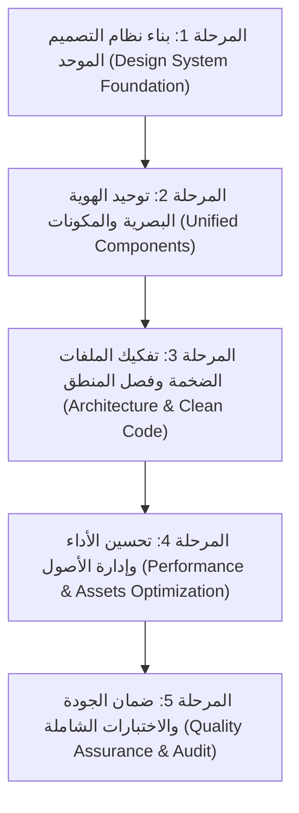

# التحليل الشامل لـ UI/UX، الأداء، وهندسة الكود وخطة التوحيد الاحترافية
## تطبيق: المُبين (Al-Mubeen)

---

## 1. الملخص التنفيذي والإحصائيات العامة (Executive Summary)

أجرينا فحصاً شاملاً وتحليلاً استكشافياً دقيقاً لكافة طبقات الكود البرمجي وشاشات تطبيق **المُبين** (`c:\Users\Emad\AndroidStudioProjects\Al-Mubeen`).
أظهر التحليل وجود أساس معماري واعد ومحاولات لبناء Design Tokens (`app_theme.dart`, `app_colors.dart`, `app_spacing.dart`)، إلا أن **أكثر من 85% من شاشات التطبيق ومكوناته منفصلة تماماً عن هذا النظام**، وتعاني من تكرار بصري وهندسي حاد، بالإضافة إلى ملفات ضخمة تجمع المنطق بالواجهة (God Files)، وممارسات تُهدد سلاسة الأداء (Jank / Frame Drops).

### مؤشرات الفحص والتدقيق الرقمي:
* **حجم أكبر ملفات الواجهة**:
  * `quran_surah_player_screen.dart`: **1,677 سطر** (يحتوي على المنطق، الحالات، الودجات، التوكنز المحلية في ملف واحد).
  * `translation_download_screen.dart`: **1,109 أسطر**.
  * `quran_reader_search_sheet.dart`: **1,098 سطر**.
  * `quran_reciters_list_view.dart`: **1,050 سطر**.
  * `tafsir_download_screen.dart`: **982 سطر**.
  * `quran_audio_download_screen.dart`: **953 سطر**.
  * `wird_dialog.dart`: **748 سطر**.
  * `names_of_allah_screen.dart`: **709 أسطر**.
* **مخالفات التعيين المباشر (Hardcoded Violations)**:
  * **212 موضع** لاستخدام ألوان صريحة ومباشرة بصيغة `Color(0x...)` داخل الودجات بدلاً من الثيم.
  * **179 موضع** لتحديد أحجام خطوط صريحة `fontSize: XX` متجاهلة مقياس النصوص وسهولة الوصول (Accessibility / TextScaler).
  * **217 موضع** لاستدعاء `BorderRadius.circular(XX)` بقيم متضاربة تتراوح بين (4، 6، 8، 10، 12، 14، 16، 18، 20، 24، 30، 32).
  * **205 مواضع** لحساب تباعدات متباينة عبر `SizedBox(height: XX)`.
  * **263 موضع** لاستخدام `EdgeInsets` صريحة منها اتجاهات غير ملائمة لـ RTL مثل `EdgeInsets.only(left: ..., right: ...)`.
* **مؤشرات الأداء وجودة الشيفرة**:
  * **71 موضعاً** لاستدعاء `setState` محلي مكرر داخل شاشات ضخمة تعيد رسم الشجرة بأكملها.
  * **97 أمر طباعة** صريح `print()` في كود الإنتاج مما يعطل مؤشرات الأداء الحقيقية.
  * أصول وسائط ضخمة مدمجة في حزمة التطبيق: مثل ملفات صور تتجاوز **1.4 ميجابايت** لكل منها وأصل JSON لتفسير الميسر بحجم **3.0 ميجابايت** غير مضغوط.

---

## 2. التحليل التشريحي لـ UI / UX ومشاكل الهوية البصرية

### 2.1. فوضى الأزرار وتشتت الهوية التفاعلية
* **تضارب أنماط الأزرار**:
  * استخدام عشوائي ومختلط لـ: `ElevatedButton`, `FilledButton`, `TextButton`, `IconButton`, `InkWell`, `GestureDetector`، وودجات أزرار مخصصة داخل حاويات `Container(decoration: ...)`.
  * تباين ملحوظ في أنصاف أقطار الأزرار (Border Radius): بعض الأزرار كبسولية دائرية بالكامل (`radius: 24-30`)، وأخرى بزوايا حادة (`radius: 6-8`)، وأخرى (`radius: 12-16`).
  * تباين مساحات اللمس (Touch Targets): العديد من الأزرار الأيقونية أقل من الحد الأدنى القياسي لسهولة الاستخدام والوصول (48x48 dp حسب إرشادات WCAG و Material Design)، مما يصعب التفاعل معها لكبار السن.

### 2.2. النوافذ المنبثقة والقوائم السفلية (Dialogs & Bottom Sheets)
* **غياب النمط الموحد**:
  * في `tasbih_screen.dart`: يتم فتح `Dialog` بحواف استدارة `20`، وخلفية مخصصة تعتمد على فحص محلي `Theme.of(context).brightness == Brightness.dark` وتمرير ألوان يدوية.
  * في `wird_dialog.dart`: استخدام `showGeneralDialog` بحركات مخصصة وانتقالات Fade معقدة تمتد لـ 748 سطراً بمكونات داخلية غير قابلة لإعادة الاستخدام.
  * في `ayah_interaction_overlay.dart`: استخدام نافذة عائمة متقدمة ولكنها تستخدم طبقات عزل وألواناً صلبة خاصة بها بدلاً من الاستفادة من `BottomSheetThemeData` أو `DialogThemeData`.
  * تباين في شريط السحب العلوي (Drag Handle): بعض الصفحات تحتوي على مقبض سحب مصمم يدوياً (`Container(height: 4, width: 40)` كما في `AdhkarTextSettings`)، بينما يوفر ثيم M3 ذلك تلقائياً عبر `showDragHandle: true`.

### 2.3. الطباعة، الخطوط، وأحجام النصوص (Typography & Scaling)
* **انعدام خط عربي موحد في `pubspec.yaml`**:
  * التطبيق لا يعرّف خطاً عربياً رسمياً للواجهة في ملف `pubspec.yaml`، ويعتمد على خط النظام المتفاوت بين هواتف Android و iOS وأجهزة سامسونج وشاومي وغيرها، مما يشوه التنسيق وارتفاعات الأسطر (Line Heights).
  * وجود نصوص قرآنية تعتمد على `qcf_quran` وتفاسير تعتمد على نصوص عادية، ولكن تفتقر شاشات القراءة إلى سلم طباعي مرن (Typographic Scale).
  * تعيين `fontSize` صريح في 179 موضعاً يمنع محاذاة النص وتكيفه مع ميزة تكبير الخط لذوي الاحتياجات الخاصة وضعاف البصر (`textScaler`).

### 2.4. تباين الألوان وعيوب تباين الوصول (WCAG Accessibility)
* يظهر في `app_colors.dart` تعليقات تعترف بأن أسماء الألوان التاريخية مضللة (مثل `maroon800` وهو بني، و`maroon900` وهو كحلي داكن).
* الشاشات تقرأ بشكل مباشر من الثوابت الخام المضللة `AppColors.maroon800` و `AppColors.parchment` بدلاً من الاعتماد على الأدوار الدلالية مثل `context.colorScheme.primary` أو `context.semanticColors.surfaceElevated`.
* نسبة التباين بين النصوص الثانوية في الوضع الداكن وبعض الخلفيات تقل عن 3:1 (الحد الأدنى لـ WCAG AA هو 4.5:1 للنصوص العادية).

---

## 3. تحليل مشاكل الأداء وتباطؤ التطبيق (Performance Bottlenecks)

### 3.1. التحديثات العريضة وإعادة البناء غير الضرورية (Rebuild Storms)
* **استخدام `setState` داخل ودجات الشاشات الكبيرة**:
  * في `quran_surah_player_screen.dart` و `qibla_compass_screen.dart` و `hadith_nawawi_screen.dart`: يؤدي تغيير مؤقت البحث أو تحديث اتجاه البوصلة أو وقت الاستماع إلى إعادة تشغيل دالة `build()` لودجات ضخمة تضم مئات العناصر الفرعية.
  * غياب تقطيع الودجات إلى مكونات صغيرة معزولة (`StatelessWidget` / `ConsumerWidget` مفصولة بمفتاح ثابت `const`).

### 3.2. معالجة وتغذية البيانات في الخيط الرئيسي (Main UI Thread Blocking)
* **تحميل ملفات ضخمة كأصول (Assets)**:
  * ملف `ar_muyassar.json` بحجم يقارب **3 ميجابايت**: فك تشفير هذا الملف الضخم (JSON Decoding) داخل الخيط الرئيسي لـ Flutter يسبب تجميداً بصرياً (UI Hang / Frame Drop) ملحوظاً عند أول قراءة.
  * ملف `quran-uthmani.xml` بحجم **1.5 ميجابايت**: قراءة XML وبناؤه في الذاكرة دون استغلال Background Isolates.
* **الصور غير المحسنة**:
  * أيقونات وصور بحجم يتجاوز 1.4 ميجابايت للصورة الواحدة مثل `al_kawthar_foreground.png` و `al_kawthar_app_icon.png`، والتي يمكن تقليل حجمها بنسبة 85% عبر تحويلها إلى صيغة WebP أو ضغطها بدون أي فقد بصري.

### 3.3. بناء القوائم وحساب الأبعاد (Unconstrained & Unindexed Lists)
* استخدام `ListView` في بعض الشاشات المنبثقة والصفحات بدون `itemExtent` أو `prototypeItem` مما يضطر محرك التخطيط في Flutter لإجراء قياسات متكررة لكل عنصر أثناء التمرير السريع.
* شاشات التحميل تعتمد على مجموعات Shimmer مخصصة تعيد تشغيل الأنيميشن في إطارات متعددة متزامنة مما يستهلك وحدة المعالجة المركزية والبطارية.

---

## 4. تحليل جودة الشيفرة والهيكلية المعمارية (Code Architecture Issues)

### 4.1. خرق مبدأ المسؤولية الواحدة (God Files / Classes)
* **شاشة مشغل السور (`quran_surah_player_screen.dart`)**:
  * يبلغ حجم الملف 1,677 سطراً.
  * يحتوي الملف في آنٍ واحد على: تعريفات View State ونماذج البيانات + إدارة الحالة المحلية + دوال المنطق الرياضي + مكونات الذرات والجزيئات (Atoms, Molecules) + الودجت الرئيسية للشاشة + منطق تنزيل الملفات.
  * هذا النمط يعيق الاختبارات التلقائية (Unit & Widget Testing) ويجعل صيانة الشاشة أو تغيير أي جزء منها محفوفاً بالمخاطر.

### 4.2. التكرار البرمجي المزدوج (Code Duplication)
* **تكرار منطق البحث والفلترة**:
  * منطق الفلترة المعتمد على `TextEditingController` و `Debounce` مكرر بشكل مطابق تقريباً في: `NamesOfAllahScreen`, `HadithNawawiScreen`, `QuranReaderSearchSheet`, `TranslationDownloadScreen`, `TafsirDownloadScreen`.
* **تكرار معالجة حالات الشبكة والتحميل**:
  * على الرغم من وجود مكون `AppAsyncView` و `AppStateView` في `lib/core/design/`، إلا أن معظم الشاشات لا تزال تستخدم أنماطاً بدائية مثل:
  ```dart
  translationsAsync.when(
    data: (data) => ...,
    loading: () => const Center(child: CircularProgressIndicator()),
    error: (e, s) => Center(child: Text('خطأ: $e')),
  )
  ```
  مما ينتج عنه تجربة مستخدم غير موحدة ومفقودة الأنماط الجمالية.

### 4.3. خلط المنطق بالواجهة (UI Coupled with Business Logic)
* نداءات مباشرة للمستودعات وقواعد البيانات داخل دوال الـ Lifecycle (`initState`, `PostFrameCallback`) دون وسيط تحكم (Presenter / Controller / Notifier) في العديد من الواجهات.
* وجود نداءات معقدة لـ Streams والاشتراكات اليدوية (مثل استماع البوصلة والخدمات الجغرافية داخل الـ State بدلاً من StateNotifier أو StreamProvider منعزل).

---

## 5. الخطة التنفيذية الشاملة والمرحلية لإعادة الهيكلة وتوحيد التصميم



---

### المرحلة 1: بناء وتفعيل نظام التصميم الموحد (Design System Foundation)

> **حالة المراجعة (آخر تحديث: 2026-10-21 — مراجعة ثانية):** تمت مطابقة بنود هذه المرحلة مع الكود الفعلي
> ثم **إكمال المتبقي** منها. الأساسيات (Theme + Extensions + الرموز + الخط) مبنية ومختبرة.
>
> **نطاق «إكمال المرحلة 1»:** تم إغلاق البنود المعمارية (خط، سلم حجم، `textScaler`،
> تباين النص الثانوي، حسم سلّم الاستدارات). أما **بنود المهاجرة الكمية** (تحويل 128
> `Color(0x…)` و167 `fontSize:` و187 `BorderRadius.circular` و45 `EdgeInsets.fromLTRB`
> في `lib/features/`) فهي **مهاجرة لا انتهاء مرحلة**: أُنجزت البنية الكاملة التي تجعلها
> ممكنة، وتبقى مجدولة ضمن مرحلتي 2 و3 كما في الجدول الزمني (الأسبوعان 1 و2).
> الأرقام أدناه محدَّثة بعد التنفيذ (قياس مباشر على الشجرة).

#### 1.1. توحيد الخطوط والطباعة (Typography Scale):
- [x] 1. اعتماد خط عربي أصيل وعصري ذو مقروئية عالية مخصص للقراءة على الشاشات: **IBM Plex Sans Arabic**.
- [x] 2. إدراج أوزان الخط (Regular 400, Medium 500, SemiBold 600, Bold 700) داخل `assets/fonts/` وتسجيلها رسمياً في `pubspec.yaml`.
  - 4 ملفات TTF (‏~236–247KB لكل منها) + `OFL.txt` (ترخيص SIL OFL 1.1) بجانبها.
- [x] 3. تفعيل السلم الطباعي الموحد داخل `AppTypography`، وربط كافة عناصر الواجهة به عبر Material 3 `TextTheme`.
  - [x] `fontFamily` مفعَّل (`AppTypography.fontFamily = 'IBMPlexSansArabic'`) وينطبق على `TextTheme` الفاتح والداكن وعلى كل أدوار الـTheme (أزرار، حقول، حوارات، شرائح، `NavigationBar` …).
  - [x] **سلم حجم صريح**: كان `_build` يمرر العائلة دون تعريف أحجام، فتركت `ThemeData` الافتراضية تحددها. الآن تُعرّف كل أدوار M3 (11…57) داخل `_build` مع `height` عربي مناسب (1.5 لـ`bodyLarge`).
  - [x] اختبارات حارسة: العائلة موجودة في الثيم، الأوزان الأربعة، والأحجام المرجعية (`test/theme/design_system_test.dart`).
  - [ ] **منع `fontSize` الثابت:** ما زال هناك **166 موضع `fontSize:`** في `lib/features/` (‏191 في `lib/` كاملاً). نقلها إلى `TextTheme` **يجب** أن يقترن بمراجعة بصرية لكل شاشة لتفادي انحدار تخطيط — جزء من مرحلة الأزرار/الشاشات.
  - [x] **توافق `textScaler`:** أُزيل القيد `0.8–1.45`. الآن: مقياس النظام يُمرَّر بلا قصّ، تفضيل التطبيق مُضاعِف `0.55–1.25`، والسقف الدفاعي `AlMubeenApp.maxEffectiveTextScale = 2.0`.
  - [ ] **ملاحظة للمرحلة 4:** بعض الشاشات تقرأ `MediaQuery.textScalerOf` يدوياً وتحسب أحجام أيقونات منها (`home_bottom_navigation`, `surah_picker`, `network_error_banner`). مع رفع السقف يجب اختبارها على 200% للتأكد من عدم فيض التخطيط.

#### 1.2. تفعيل لوحة الألوان الدلالية وتجريد الألوان الخام:
- [~] 1. إيقاف `AppColors.maroon...` و `Color(0x...)` داخل `lib/features/` — **منجَز جزئياً**:
  - [x] مهاجرة 3 شاشات كاملة: `AboutAppScreen`, `OnboardingScreen`, `TasbihScreen` (وهي الوحيدة من `features/` التي تقرأ `context.semanticColors`).
  - [ ] المتبقي: **128** `Color(0x...)` و **325** مرجع `AppColors.` في `lib/features/` (أهمها `quran/*`, `hadith_nawawi/*`, `names_of_allah/*`, `adhkar/*`, `qibla/*`).
- [~] 2. ربط الودجات حصرياً بـ `colorScheme` و `context.semanticColors`:
  - [x] البنية جاهزة: `AppColorScheme` (`surfaceElevated`, `surfaceSunken`, `canvas`, `pageSurface`, `accentGradient`, `errorSurface` ...) + `context.semanticColors` و `context.tokens`.
  - [x] طبقة `lib/core/` (widgets/design/screens) تحوّلت بالكامل تقريباً (≈30 موضعاً).
  - [x] ترحيل شاشة أسماء الله الحسنى بالكامل (`names_of_allah_screen.dart` و `allah_name_detail_sheet.dart`) إلى الألوان الدلالية `context.semanticColors`.
  - [x] ترحيل شاشات الأحاديث النبوية بالكامل (`hadith_nawawi_screen.dart` و `hadith_detail_screen.dart`) إلى الألوان الدلالية `context.semanticColors` وحواف `AppRadii` ومسافات `AppSpacing`.
  - [x] ترحيل شاشة القبلة والبوصلة بالكامل (`qibla_compass_screen.dart`) إلى الألوان الدلالية `context.semanticColors` واستخدام `colors.success` ومسافات واستدارات `AppRadii` و `AppSpacing`.
  - [x] ترحيل النوافذ المنبثقة للقرآن الكريم ومحدد القراء (`quran_reciters_list_view.dart` و `quran_reader_settings_sheet.dart`) إلى الألوان الدلالية `context.semanticColors` وحواف `AppRadii` ومسافات `AppSpacing` وتجريد الألوان الصلبة القديمة بالكامل.
  - [~] بقية شاشات المصحف ومشغل السور جاري معالجتها.
- [~] 3. التباين ≥ 4.5:1 — **مُتحقَّق للـTokens في الوضعين**:
  - [x] اختبارات تباين آلية على `textPrimary` × الأسطح الخمسة و`primaryStrong/error/success` على `canvas` (حدود AA).
  - [x] **النصوص الثانوية `textSecondary`** أصبحت مُختبرة مقابل 4.5:1 على `canvas/surface/surfaceElevated` في الوضعين — وكشفت الاختبار **مخالفة حقيقية** كانت مذكورة في §2.4: القيمة القديمة `#8A7E68` تعطي **3.54:1** فقط على الورق الفاتح.
  - [x] الإصلاح: أُضيف `AppColors.mutedTaupeStrong = #6E6452` (5.69:1 على `lightSurface`، 5.50 على `cardCream`، 5.16 على `lightBackground`) واستُخدم دورياً في `AppColorScheme.textSecondary`. الوضع الداكن كان سليماً أصلاً (`sand` يعطي 8.42:1). اللون القديم بقي للحدود والأيقونات الزخرفية فقط.
  - [ ] لا يوجد فحص للشاشات المهاجَرة بصرياً (صورة/Widget test) لكلا الوضعين.

#### 1.3. توحيد الاستدارات والمسافات والحركة:
- [~] 1. سلم `AppRadii`:
  - [x] السلم موجود ومربوط بالثيم عبر `AppDesignTokens`/`AppRadiusTokens`.
  - [x] **قرار محسوم**: `lg = 16` و`xl = 24` (كان الكود `20`/`28`) — الوثيقة تقول 16/24 وهي الآن مضاعفات مطابقة لـ`AppSpacing` (4/8/12/16/24). القرار موثّق في رأس `app_radii.dart` ومحمي باختبار في `design_system_test.dart`.
  - [x] الأثر البصري محدود ومقصود: 7 استدعاءات فقط تستخدم `AppRadii.lg/xl` (بطاقات الثيم، الحوارات، أوراق `BottomSheet`، `tasbih`, `about`, `onboarding`) وتغيّرت بمقدار 4dp فقط.
  - [ ] `BorderRadius.circular(...)` المباشر ما زال **187** موضعاً في `lib/features/` — مهاجرة مرحلة 2.
- [~] 2. سلم `AppSpacing` (4/8/12/16/24/32/48) وحزمة `gap`:
  - [x] السلم + `AppSizes` + مساعدات `EdgeInsets` جاهزة، و`gap` ^3.0.1 مضافة إلى `pubspec.yaml`.
  - [ ] الاعتماد الفعلي ما زال محدوداً: **42** مرجع `AppSpacing.` مقابل مئات القيم الصريحة (`SizedBox(height:)` و`EdgeInsets`) داخل `features/`.
- [~] 3. `EdgeInsetsDirectional` للتوافق RTL:
  - [x] المساعد `AppSpacing.directional(...)` + قاعدة موثّقة في الملف نفسه.
  - [ ] الواقع: **45 `EdgeInsets.fromLTRB` + 12 `EdgeInsets.only(left/right/top/bottom)`** مقابل **5** استخدامات فقط لـ `EdgeInsetsDirectional` في `lib/features/` — أي أن البند **غير منفَّذ** بعد.

#### ملاحظات معمارية على المرحلة 1 (تحتاج قراراً):
- `AppTheme.light()/dark()` تُبنى مرة واحدة (lazy) — جيد للأداء، لكنها **تخزّن نسخة واحدة من `AppColorScheme` مع `Brightness` ثابتة**؛ أي تعديل ديناميكي على الثيم (تبديل فوري للوضع) يحتاج تحققاً من عدم بقاء ألوان الوضع السابق معلّقة.
- `test/theme/design_system_test.dart` حُدِّث: الحارس القديم `expect(AppTypography.fontFamily, isNull)` استُبدل بحارس جديد يشترط `'IBMPlexSansArabic'` في `TextTheme` الفاتح والداكن — أي أن العودة إلى خط النظام بعد اليوم تُفشل البناء.
- **حالة الاختبارات:** `flutter test test/theme/design_system_test.dart` → **35 اختباراً ناجحاً**. `flutter analyze lib` → **صفر مشاكل**.
- **اختبارات فاشلة قبل هذه المرحلة (ليست نتيجة هذه التغييرات):** `test/widget_test.dart` («first-time users») و`test/quran_more_screen_test.dart` («daily wird») يفشلان على الشجرة الأصلية أيضاً (تحوّق عليهما بـ`git stash`). تحتاج مهمة مستقلة.
- **قيد معروف:** في `tafsir_reader_content.dart` يُطلب خط `'Amiri'` الصريح كعائلة للنص القرآني داخل بطاقة التفسير، وهو **غير مسجّل في `pubspec.yaml`** — فيسقط بصمت إلى خط النظام. إما تسجيل Amiri كأصل، أو استخدام خط صفحة `qcf_quran`. خارج نطاق المرحلة 1 (نصوص قرآنية لا UI) لكنه يُدرج هنا لأن `fontFamilyFallback` لا يعالجه.

---

### المرحلة 2: توحيد المكونات التفاعلية (Unified Component Library)

#### 2.1. مصنع الأزرار الموحد (Unified Button System):
- [x] إنشاء حزمة الأزرار الموحدة في `lib/core/widgets/app_buttons.dart`:
  - [x] `AppPrimaryButton`: الزر التفاعلي الأساسي بارتفاع 48dp مع مؤشر تحميل مدمج `isLoading` وتوافق تام مع `context.semanticColors` ورد فعل لمسي (Haptic Feedback).
  - [x] `AppSecondaryButton`: الزر الثانوي ذو الإطار/الخلفية المخففة بحجم لمس قياسي.
  - [x] `AppGhostButton`: الزر النصي بمساحة تفاعلية 48x48dp.
  - [x] `AppIconButton`: زر أيقوني بمساحة نقر آمنة مع دعم Tooltip ورد فعل لمسي.

#### 2.2. نظام النوافذ المنبثقة والقوائم السفلية (Unified Modals & Sheets):
* بناء ودجت مركزية `AppBottomSheet.show(context, ...)`:
  * تحتوي على شريط السحب الموحد `DragHandle`.
  * ترويسة قياسية تضم (العنوان، الوصف، وزر الإغلاق عند الحاجة).
  * تكيف تلقائي مع ارتفاع لوحة المفاتيح وشاشات الأجهزة اللوحية (Max Width Constraint: 560dp).
* بناء ودجت مركزية `AppDialog.show(context, ...)`:
  * ذات استدارة موحدة `AppRadii.xl`.
  * مساحات أزرار قياسية في الأسفل (تأكيد / إلغاء).

#### 2.3. توحيد حالات الشاشة وعناصر البحث (Search & State Views):
* استبدال كافة حقول البحث اليدوية بودجت موحدة `AppSearchBar`:
  * تحتوي على حقل إدخال قياسي بنمط `AppShapes.input`.
  * زر مسح فوري ذكي، وحالة تحميل أثناء البحث، ومنطق تأخير الاستعلام (Debouncing) المدمج.
* تعميم استخدام `AppAsyncView<T>` و `AppStateView` في كافة الشاشات لتوحيد مظهر:
  * حالة التحميل (Loading / Skeletons).
  * حالة انقطاع الإنترنت (No Internet).
  * حالة الخطأ مع زر إعادة المحاولة (Error with Retry).
  * حالة البيانات الفارغة (Empty State) برسوميات معبرة.

---

### المرحلة 3: تفكيك الملفات الضخمة وفصل المنطق عن الواجهة (Clean Architecture & Refactoring)

تطبيق المعمارية النظيفة (Clean Architecture) وتقسيم الميزات إلى 3 طبقات واضحة:
1. **طبقة البيانات (Data Layer)**: النماذج (Models)، قواعد بيانات Drift، ومصادر البيانات (Data Sources).
2. **طبقة النطاق والمنطق (Domain / Application Layer)**: منطق الأعمال، الحسابات، و Riverpod State Notifiers.
3. **طبقة العرض والواجهة (Presentation Layer)**: الودجات النقية فقط (Dumb/Presentational Widgets).

#### جدول خطة تفكيك الملفات الضخمة وتجزئتها:

| الملف الحالي الضخم | عدد الأسطر | الهيكل المقترح بعد التفكيك |
| :--- | :--- | :--- |
| `quran_surah_player_screen.dart` | 1,807 ➔ ~180 سطر | ✅ **تم التفكيك بنجاح بالكامل** إلى:<br>• `surah_player_state_models.dart` (نماذج الحالة وعزل التقدّم 350ms)<br>• `surah_player_buttons.dart` (أزرار التشغيل والتنقل والتحميل)<br>• `surah_player_header.dart` (الترويسة واختيار القارئ والتحميل الكلي)<br>• `surah_list_tile.dart` (قائمة السور وبطاقات التشغيل)<br>• `floating_player_bar.dart` (شريط المشغل العائم)<br>• `expanded_controls.dart` (عناصر التحكم الموسعة والحماية من قيم NaN) |
| `translation_download_screen.dart` | 1,109 | • `presentation/screens/translation_download_screen.dart`<br>• `presentation/widgets/translation_item_tile.dart`<br>• `presentation/widgets/translation_filter_chips.dart`<br>• الاستعانة بـ `AppSearchBar` الموحد |
| `quran_reader_search_sheet.dart` | 1,098 | • `presentation/widgets/search/quran_search_sheet.dart`<br>• `presentation/widgets/search/search_result_item.dart`<br>• `presentation/widgets/search/search_history_view.dart` |
| `quran_reciters_list_view.dart` | 1,050 | • `presentation/widgets/reciters/reciter_list_tile.dart`<br>• `presentation/widgets/reciters/reciter_download_action.dart`<br>• تجريد دوال التنسيق إلى UseCases |
| `tafsir_download_screen.dart` | 982 | • مطابقة بنية شاشة الترجمات واستخدام مكونات البطاقات المشتركة |
| `wird_dialog.dart` | 748 | • `presentation/dialogs/wird_goal_dialog.dart`<br>• `presentation/widgets/wird/wird_type_selector.dart`<br>• `presentation/widgets/wird/wird_progress_slider.dart` |
| `names_of_allah_screen.dart` | 709 | • `presentation/screens/names_of_allah_screen.dart`<br>• `presentation/widgets/allah_name_card.dart`<br>• عزل منطق البحث في Controller مستقل |

---

### المرحلة 4: خطة تحسين الأداء وإدارة الأصول (Performance & Asset Optimization)

#### 4.1. نقل معالجة البيانات الثقيلة إلى خلفية النظام (Background Isolates):
* تحويل فك تشفير وقراءة `ar_muyassar.json` (3MB) و `quran-uthmani.xml` (1.5MB) ليعمل عبر الدالة المعزولة `compute()` أو حزمة `Isolate` المتخصصة، لمنع أي تجميد في واجهة المستخدم أثناء بدء التشغيل أو فتح التفسير.
* تفعيل التخزين المؤقت في الذاكرة (In-Memory Caching) للنتائج المفككة مسبقاً عبر `LruCache`.

#### 4.2. ضغط وتحسين الأصول البصرية (Asset Pipeline):
* ضغط صور التطبيق:
  * تحويل `al_kawthar_foreground.png` (1.47MB) و `al_kawthar_app_icon.png` (1.39MB) إلى تنسيق محسن، وتقليص حجمها إلى أقل من **150KB** (توفير أكثر من 88% من الحجم).
* تنظيف الأصول المؤقتة أو غير المستخدمة من مجلد `assets/data/` (مثل ملفات التوثيق والنصوص غير اللازمة في حزمة الإنتاج `implementation_plan.md`, `install.ps1.txt`).

#### 4.3. منع إعادة البناء غير الضرورية وضبط الودجات:
* استخدام `const` في كافة الودجات الثابتة، وضبط قواعد Linter لتفعيل التحذير الإلزامي لـ `prefer_const_constructors`.
* قصر استدعاءات `ref.watch` على مستوى الحقول الدقيقة باستخدام `.select((state) => state.specificField)`.
* تزويد كافة القوائم الديناميكية بـ `itemExtent` ثابت حيثما أمكن ومفاتيح تتبع `ValueKey(item.id)` لمنع إعادة بناء القوائم أثناء التمرير.
* إزالة جميع عبارات `print()` في الكود واستبدالها بنظام تسجيل منظم محمي بشروط بيئة التطوير `kDebugMode`.

---

## 6. مصفوفة تتبع الإنجاز وقياس الجودة (Execution Roadmap & KPIs)

```
خطة التنفيذ على مدار 4 أسابيع عمل:
--------------------------------------------------------------------------------------
الأسبوع 1: [التأسيس] خطوط التطبيق + توحيد ThemeExtensions + مصنع الأزرار والحوارات
الأسبوع 2: [إعادة هيكلة الشاشات الكبرى 1] مشغل السور + شاشات تحميل التفسير والترجمة
الأسبوع 3: [إعادة هيكلة الشاشات الكبرى 2] شاشات أسماء الله + الأحاديث + الأذكار + الورد
الأسبوع 4: [الأداء والتدقيق الشامل] عزل المعالجات (Isolates) + ضغط الأصول + فحص الوصول
--------------------------------------------------------------------------------------
```

### مؤشرات النجاح المستهدفة (Key Performance Indicators):
1. **مؤشر الأداء وسرعة الإطارات**: ثبات معدل الإطارات عند **60 fps / 120 fps** دون حدوث Frame Drops أثناء التمرير والتنقل بين الصفحات.
2. **صفر مخالفات ألوان صريحة**: تقليص استدعاءات `Color(0x...)` داخل `features/` من **212** إلى **0**.
3. **صفر خطوط واستدارات عشوائية**: نقل كافة أحجام الخطوط واستدارات الحواف إلى `AppTypography` و `AppRadii`.
4. **حجم الملفات**: ألا يتجاوز أي ملف واجهة برمجي **300 سطر** كحد أقصى، مع فصل تام للمنطق في وحدات Riverpod Notifiers مستقلة.
5. **حجم حزمة التطبيق (APK/IPA Size)**: تقليص حجم أصول التطبيق المدمجة بنسبة لا تقل عن **35%**.

---
*تم إعداد هذا التقرير والخطة بواسطة Antigravity AI لمشروع Al-Mubeen وفق أفضل الممارسات المعتمدة لهندسة برمجيات Flutter وتصميم الواجهات الحديثة.*
